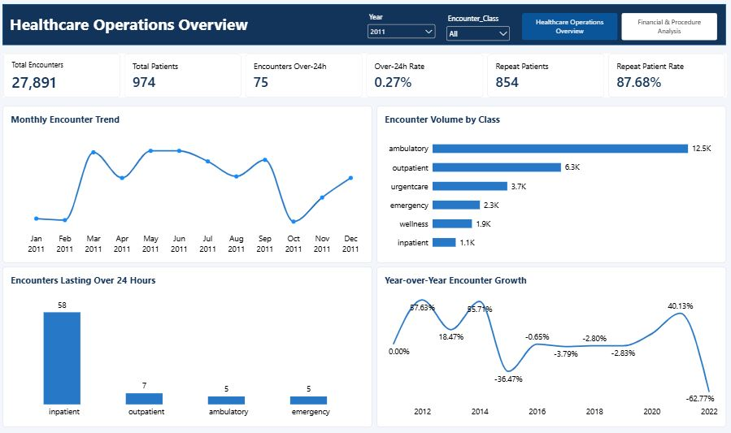
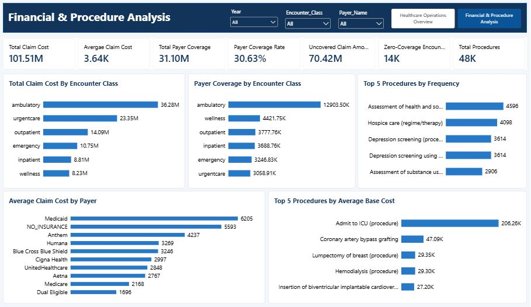

# Healthcare Operations & Financial Intelligence Dashboard

An interactive Power BI project analysing healthcare encounters, patient activity, procedure utilisation, claim costs and payer coverage.

## Project Overview

Healthcare organisations generate data from patient encounters, medical procedures and financial transactions. Looking at these records individually does not always provide a clear picture of operational activities or financial performance.

For this project, I worked with five datasets covering encounters, patients, procedures, payers and healthcare organisations. I used Power BI to prepare and model the data, develop KPIs, investigate key business questions and build an interactive dashboard.

The goal was to turn the available data into useful information that could support operational monitoring, financial analysis and better decision-making.

## Project Objectives

- Analyse healthcare encounter patterns over time.
- Understand how encounter volumes are distributed across encounter classes.
- Identify encounters lasting more than 24 hours.
- Examine claim costs across encounter classes.
- Assess recorded payer coverage and encounters with zero coverage.
- Identify frequently performed procedures.
- Compare average claim costs across payers.
- Examine procedures with the highest average base costs.

## Tools and Technologies

- Microsoft Power BI – Data modelling, DAX calculations and dashboard development.
- Power Query – Data cleaning, transformation and preparation.
- DAX – KPI calculations and analytical measures.
- Microsoft Excel – Data quality assessment and supporting checks.

## Dataset Overview

The project used five datasets:

| Dataset | Records | Description |
|---|---:|---|
| Encounters | 27,891 | Encounter details, dates, classes and financial information |
| Patients | 974 | Patient records |
| Procedures | 47,701 | Procedure records |
| Payers | 10 | Payer information |
| Organizations | 1 | Healthcare organisation information |

The data covers January 2011 to February 2022.

## Data Preparation and Modelling

Before building the dashboard, I assessed the datasets and prepared them for analysis.

The preparation process included:

- Reviewing the structure and fields available in each dataset.
- Renaming columns for consistency and readability.
- Correcting data types, including date, time and numeric fields.
- Reviewing missing values and documenting relevant data quality issues.
- Checking for duplicate records.
- Investigating unusual encounter durations and procedure costs.
- Checking key fields to identify unmatched records between related datasets.

Missing values were not automatically removed. They were reviewed and handled according to their relevance to the analysis.

### Data Model

I created relationships between the datasets using their common identifiers.

The model included:

- Patients connected to Encounters through `Patient_ID`.
- Organizations connected to Encounters through `Organization_ID`.
- Payers connected to Encounters through `Payer_ID`.
- Encounters connected to Procedures through `Encounter_ID`.
- A Calendar table connected to Encounters through the encounter date.

The direct Patients-to-Procedures relationship was left inactive because it introduced relationship ambiguity in the model.

## Dashboard Development

The dashboard contains two interactive pages.

## Dashboard Preview

### Page 1: Healthcare Operations Overview

This page focuses on encounter activity, patient activity and encounter duration.

Key Performance Indicators:

| KPI | Value |
|---|---:|
| Total Encounters | 27,891 |
| Total Patients | 974 |
| Encounters Over 24 Hours | 75 |
| Over-24-Hour Encounter Rate | 0.27% |
| Repeat Patients | 854 |
| Repeat Patient Rate | 87.68% |

Visualisations:

- Monthly Encounter Trend
- Encounter Volume by Class
- Encounters Lasting Over 24 Hours
- Year-over-Year Encounter Growth

Year and Encounter Class slicers allow users to explore the encounter data.

### Page 2: Financial & Procedure Analysis

This page examines healthcare claim costs, payer coverage and procedure utilisation.

Key Performance Indicators:

| KPI | Value |
|---|---:|
| Total Claim Cost | ₦101.51 million |
| Average Claim Cost | ₦3.64 thousand |
| Total Payer Coverage | ₦31.10 million |
| Payer Coverage Rate | 30.63% |
| Uncovered Claim Amount | ₦70.42 million |
| Zero-Coverage Encounters | Approximately 14,000 |
| Total Procedures | 47,701 |

Visualisations:

- Total Claim Cost by Encounter Class
- Payer Coverage by Encounter Class
- Top 5 Procedures by Frequency
- Average Claim Cost by Payer
- Top 5 Procedures by Average Base Cost

Users can explore the financial and procedure data using Year, Payer and Encounter Class slicers.

## Key Findings

### 1. Encounter Distribution

Ambulatory encounters accounted for the largest share of recorded encounters, with 12,537 records (44.9%).

Ambulatory, Outpatient and Urgentcare together accounted for 80.6% of all encounters.

### 2. Encounter Duration

A total of 75 encounters lasted more than 24 hours, representing 0.27% of encounters with valid timestamps.

Inpatient encounters accounted for 58 of these cases, representing the largest share of encounters exceeding 24 hours.

### 3. Encounter Trends

The monthly encounter analysis showed changes in activity across the years.

The highest recorded monthly volume was 1,178 encounters in February 2014. This stood out from surrounding months and was flagged for further verification rather than treated as a confirmed increase in activity.

Encounter volume also increased by 40.1% in 2021 compared with 2020.

The reported 62.8% decrease for 2022 represents a January–February comparison with the same period in 2021. The 2022 dataset contains only two months of records.

### 4. Claim Costs and Payer Coverage

Total claim cost was approximately ₦101.51 million, while recorded payer coverage was approximately ₦31.10 million.

This represented a payer coverage rate of 30.63%.

The difference between the two figures was approximately ₦70.42 million. This represents the portion of claim costs not covered by the recorded payer coverage figures and should not automatically be interpreted as patient debt or confirmed unpaid claims.

Ambulatory encounters accounted for the highest total claim cost at approximately ₦36.28 million.

### 5. Procedure Utilisation

Assessment of health and social care needs was the most frequently recorded procedure, with 4,596 records.

Other frequently recorded procedures included hospice care and depression screening.

### 6. Average Claim Cost by Payer

Medicaid recorded the highest average claim cost at ₦6,205.22, while Dual Eligible recorded the lowest at ₦1,696.19.

These figures show differences in average claim costs across the payer categories but do not explain the reasons behind those differences.

### 7. Procedure Base Costs

Admit to ICU had the highest average procedure base cost among the five procedures displayed, at approximately ₦206.26 thousand.

This value was considerably higher than the next procedure. It was therefore identified as requiring further investigation before drawing conclusions about procedure costs.

## Recommendations

Based on the analysis, I recommend the following:

1. Review encounters exceeding 24 hours, particularly inpatient encounters, to understand the reasons for longer recorded durations. Timestamp accuracy should be confirmed before using these figures to assess operational delays.

2. Investigate the difference between total claim costs and recorded payer coverage. Reviewing payer and claim-processing records could provide a clearer picture of coverage and outstanding amounts.

3. Monitor frequently performed procedures to support resource planning, staffing and the management of medical supplies.

4. Investigate unusually high procedure base costs, especially Admit to ICU, to understand the underlying records and confirm that the figures are suitable for cost comparisons.

## Validation and Data Limitations

I performed arithmetic reconciliation checks to assess the consistency of important dashboard figures.

The checks included:

- Adding monthly encounter figures and comparing the result with the total encounter KPI.
- Adding encounter counts across all six encounter classes and comparing the result with total encounters.
- Adding encounters exceeding 24 hours across encounter classes and comparing the result with the corresponding KPI.
- Reconciling displayed claim cost and payer coverage breakdowns against their respective KPI totals.

The monthly encounter figures and encounter class figures both reconciled to 27,891. The encounter duration breakdown reconciled to 75.

The following limitations were also identified:

- February 2014 recorded an unusually high encounter count of 1,178 and requires source verification.
- The 2022 data covers only January and February.
- Some encounter and procedure duration records contain unusually high values.
- Payer coverage represents recorded coverage and does not confirm actual payments or reimbursements.
- The uncovered claim amount should not be treated as confirmed patient debt.
- High procedure base costs require further investigation before being used for budgeting decisions.

The reconciliation checks confirm internal consistency between the displayed figures, but they do not replace independent calculations from the original source columns.

## Project Deliverables

- Interactive Power BI dashboard with two pages.
- Data Quality Assessment workbook.
- KPI Definition Sheet.
- Executive Summary.
- Validation Evidence.
- Dashboard screenshots.

## What I Learned

This project gave me practical experience working through a healthcare analytics task from data preparation to dashboard development.

I worked on data cleaning, relationship modelling, DAX measures, time-based analysis, financial calculations and interactive visualisation.

One important lesson was that producing a dashboard is not just about displaying numbers. It is also about understanding how those numbers were calculated, checking whether they are consistent and recognising where the available data has limitations.

## Conclusion

The Healthcare Operations & Financial Intelligence Dashboard brings together operational and financial information to provide a clearer view of healthcare activity.

It demonstrates how data analytics can be used to examine encounter patterns, procedure utilisation, claim costs and payer coverage, while identifying areas that require further investigation.
