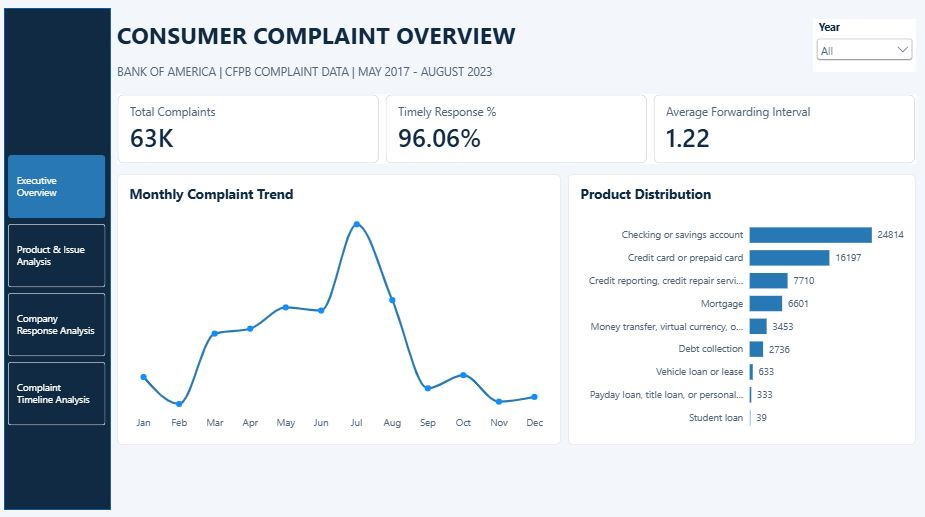
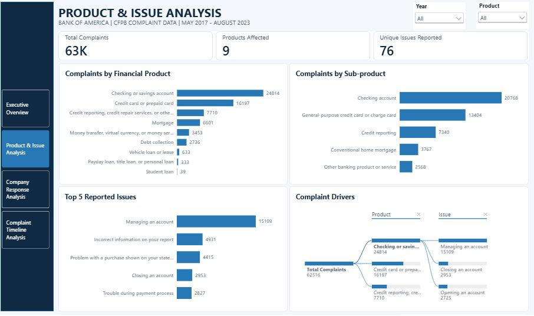
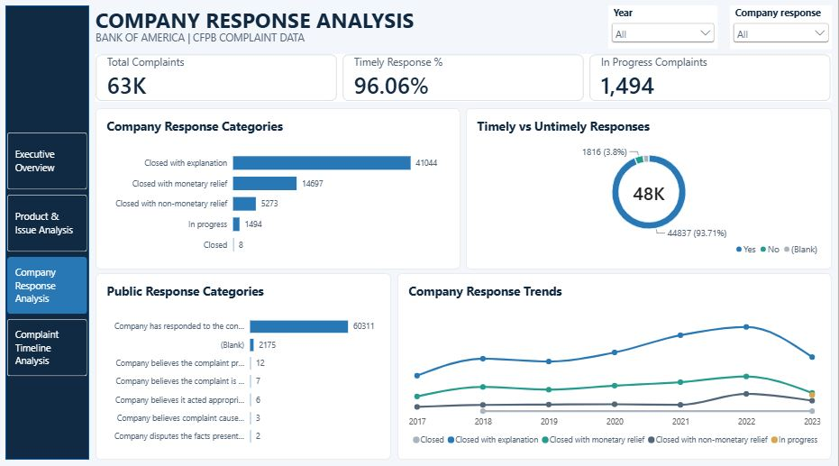
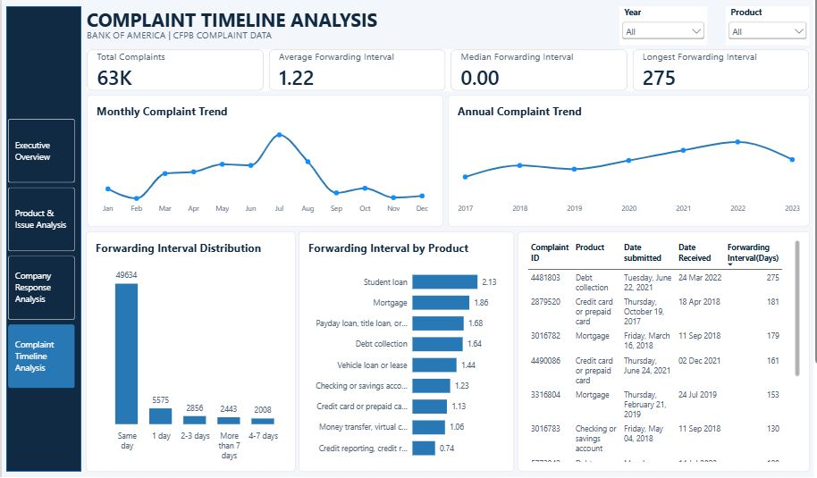

# Consumer Complaint Trends and Response Intelligence Platform

## Project Overview

This project analyses consumer complaints submitted to the Consumer Financial Protection Bureau (CFPB) concerning Bank of America between May 2017 and August 2023.

The aim was to examine complaint patterns across financial products, identify frequently reported issues, understand recorded company responses, and assess the time taken for complaints to be forwarded to the company.

Using Power BI, I cleaned and prepared the dataset, developed key performance indicators (KPIs), performed exploratory analysis, and built an interactive four-page dashboard to communicate the findings.

The analysis provides insights that can help stakeholders identify recurring complaint areas, monitor response patterns and investigate potential delays in complaint handling.

## Business Problem

Financial institutions receive complaints from consumers about their financial products and services. Understanding these complaints can help identify recurring issues, monitor response patterns and highlight areas that may require attention.

The challenge in this project was to turn the available complaint records into meaningful insights that could support better complaint monitoring and decision-making.

## Project Objectives

The project focused on:

- Analysing complaint volumes and trends from 2017 to 2023.
- Identifying financial products with the highest complaint volumes.
- Determining the most frequently reported consumer issues.
- Examining the distribution of company response categories.
- Measuring the percentage of complaints marked as receiving timely responses.
- Calculating the time between CFPB receiving a complaint and forwarding it to the company.
- Identifying unusual forwarding intervals.
- Presenting the findings through an interactive Power BI dashboard.

## Dataset Description

**Source:** Consumer Financial Protection Bureau (CFPB)

**Dataset:** Bank of America Consumer Complaints

**Period Covered:** May 1, 2017 – August 28, 2023

**Total Records:** 62,516 complaints

**Original Columns:** 12

The dataset contains the following fields:

| Field | Description |
|---|---|
| Complaint ID | Unique complaint identification number |
| Submitted via | Channel used to submit the complaint |
| Date submitted | Date the CFPB received the complaint |
| Date received | Date the CFPB sent the complaint to the company |
| State | Consumer's state |
| Product | Financial product associated with the complaint |
| Sub-product | More specific product classification |
| Issue | Main issue reported by the consumer |
| Sub-issue | More detailed issue classification |
| Company public response | Company's optional public response category |
| Company response to consumer | Recorded response category |
| Timely response? | Whether the company provided a timely response |

## Tools and Technologies

- **Microsoft Excel:** Initial dataset inspection and data validation.
- **Power Query:** Data cleaning, transformation and preparation.
- **Power BI:** Data modelling, DAX calculations, KPI development and dashboard creation.
- **DAX:** Creation of calculated measures and analytical metrics.
- **GitHub:** Project documentation and portfolio presentation.

## Data Preparation and Cleaning

Before beginning the analysis, I inspected the dataset to understand its structure, check data quality and identify issues that could affect the results.

The following checks and transformations were carried out:

1. Confirmed that the dataset contained 62,516 records and 12 original columns.
2. Checked the Complaint ID field for uniqueness. All 62,516 IDs were unique, with no duplicate IDs found.
3. Investigated missing values across the dataset.
4. Checked the date columns and confirmed that all records had valid submission and forwarding dates.
5. Confirmed that no complaint had a forwarding date earlier than its submission date.
6. Inspected categorical fields for inconsistent values. No standardisation changes were required.
7. Created a forwarding interval column to calculate the number of days between the CFPB receiving a complaint and forwarding it to the company.
8. Created forwarding interval categories for easier analysis.
9. Created a calendar table containing year, month, quarter and year-month fields for time-based analysis.

### Missing Value Treatment

Missing values were investigated rather than automatically replaced.

| Column | Missing Records | Treatment |
|---|---:|---|
| Sub-product | 7 | Retained as blank |
| Sub-issue | 10,858 | Retained as blank |
| Company public response | 2,175 | Retained as blank |
| Timely response? | 1,494 | Retained as blank |

The seven missing Sub-product values were associated with checking or savings accounts. Missing Sub-issue values were retained because not all issues require a sub-issue classification. Missing public responses were also retained because this field is optional.

The 1,494 missing timely-response values were associated with complaints marked as In Progress. These were not classified as untimely responses.

### Forwarding Interval Calculation

The forwarding interval was calculated as:

**Forwarding Interval (Days) = Date received − Date submitted**

This measures the time between the CFPB receiving a complaint and forwarding it to the company. It does not represent the company's response or resolution time.

## Key Performance Indicators (KPIs)

The following KPIs were developed to support the analysis:

| KPI | Result |
|---|---:|
| Total Complaints | 62,516 |
| Products Affected | 9 |
| Unique Issues Reported | 76 |
| Timely Response Rate | 96.06% |
| In-Progress Complaints | 1,494 |
| Average Forwarding Interval | 1.22 days |
| Median Forwarding Interval | 0 days |
| Longest Forwarding Interval | 275 days |

Additional analysis covered annual and monthly complaint volumes, product and issue distributions, company response categories, product contribution percentages and year-on-year complaint changes.

**Timely Response Calculation:** The 96.06% rate was calculated using only records marked Yes or No. The 1,494 records with blank timely-response values were excluded from the denominator.

## Power BI Dashboard

The interactive dashboard contains four pages, each focusing on a different aspect of the complaint analysis.

### 1. Executive Complaint Overview

This page provides a summary of complaint activity and key performance indicators.

It includes:
- Total complaints.
- Timely response percentage.
- Average forwarding interval.
- Monthly complaint trends.
- Complaint distribution by financial product.
- Year filter.

### 2. Product and Issue Analysis

This page examines the financial products and consumer issues associated with the complaints.

It includes:
- Complaints by financial product.
- Complaints by sub-product.
- Top 5 reported issues.
- Product and issue breakdown using a decomposition tree.
- Product and year filters.

### 3. Company Response Analysis

This page focuses on how companies responded to complaints and the recorded response categories.

It includes:
- Company response categories.
- Timely versus untimely response distribution.
- In-progress complaints.
- Public response categories.
- Company response trends over time.
- Year and company response filters.

### 4. Complaint Timeline Analysis

This page examines complaint trends and the time between CFPB receiving and forwarding complaints.

It includes:
- Average, median and longest forwarding intervals.
- Monthly and annual complaint trends.
- Forwarding interval distribution.
- Average forwarding interval by product.
- Table of the 10 longest forwarding intervals.
- Year and product filters.

## Key Business Insights

### 1. Complaint Volumes Increased Between 2019 and 2022

Complaint volumes increased from 7,075 in 2019 to 12,953 in 2022.

The largest year-on-year increase occurred in 2020, at 26.39%.

This suggests an increasing volume of complaints that complaint-handling teams may need to manage.

### 2. Three Financial Product Categories Accounted for Most Complaints

Checking or savings accounts, credit cards or prepaid cards, and credit reporting products accounted for approximately 77.93% of all complaints.

Checking or savings accounts alone contributed 39.69%.

These categories provide a useful starting point for further investigation into recurring consumer complaints.

### 3. Managing an Account Was the Most Reported Issue

Managing an account recorded 15,109 complaints, representing approximately 24.17% of the total.

It was followed by incorrect information on a credit report, with 4,931 complaints, and problems with purchases shown on statements, with 4,415 complaints.

This highlights account management as an important area for further review.

### 4. Closed With Explanation Was the Most Common Company Response

A total of 41,044 complaints were recorded as Closed with explanation, representing approximately 65.65% of all complaints.

The timely response rate was 96.06% among records with valid Yes or No values.

However, the recorded response category does not establish whether consumers were satisfied with the outcome.

### 5. Most Complaints Were Forwarded Within One Day

The analysis showed that 49,634 complaints, approximately 79.4%, were forwarded to companies on the same day.

When complaints forwarded within one day were included, the proportion increased to approximately 88.31%.

However, 2,443 complaints took more than seven days to be forwarded, and the longest recorded interval was 275 days.

These unusual intervals may require further investigation.

## Recommendations

Based on the findings, the following actions are recommended:

1. **Monitor complaint trends:** Regularly review complaint volumes and ensure that complaint-handling teams have sufficient capacity to manage changes in demand.

2. **Prioritise frequently reported products and issues:** Pay closer attention to checking and savings accounts, credit cards and credit reporting products. Investigate recurring issues to identify areas where processes or customer support can be improved.

3. **Review response and forwarding processes:** Continue monitoring response timeliness, follow up on complaints that remain in progress and investigate unusually long forwarding intervals.

## Limitations of the Analysis

- The dataset contains complaints submitted by consumers and does not establish that a company committed misconduct or violated regulations.
- Complaint volumes do not represent complaint rates because the total number of customers and transactions for each product was not provided.
- The 2017 and 2023 records cover partial years and should not be compared directly with full-year totals.
- Blank timely-response values were excluded from the timely response calculation because they were associated with complaints marked as In Progress.
- The forwarding interval measures CFPB receipt-to-forwarding time, not company response or complaint resolution time.
- The dataset alone does not explain why complaint volumes or particular issues increased.

## Project Deliverables

The project deliverables include:

- Cleaned and prepared complaint dataset.
- Data inspection and cleaning documentation.
- KPI definitions, calculations and results.
- DAX measures used for the analysis.
- Four-page interactive Power BI dashboard.
- Evidence-based business insights and recommendations.
- Project documentation.

## Conclusion

This project provided an opportunity to work through a complete data analytics process, from understanding the dataset and checking data quality to developing KPIs, analysing trends and building an interactive dashboard.

The analysis identified the financial products and issues associated with the highest complaint volumes, examined recorded company response patterns and measured complaint forwarding intervals.

More importantly, it showed how data can be organised and presented to help stakeholders understand patterns, identify areas requiring attention and make better-informed decisions.

