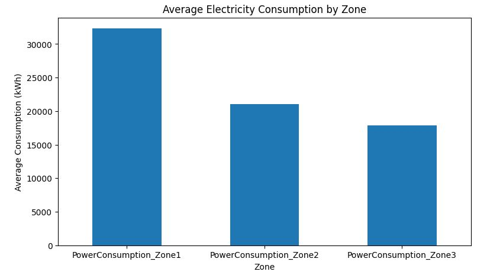
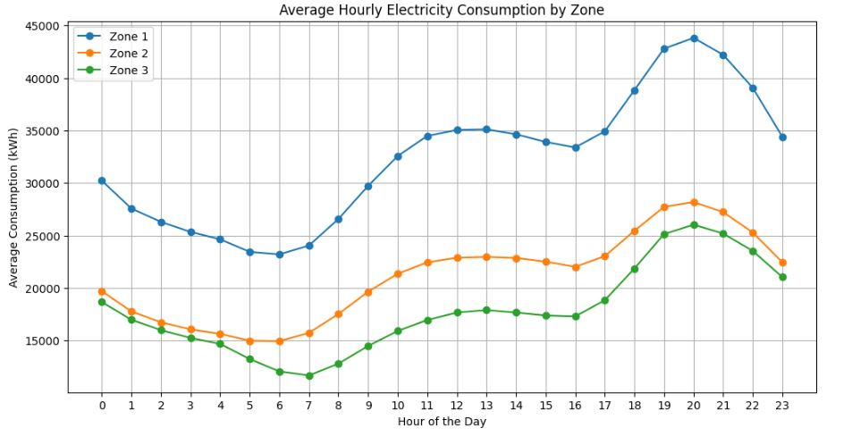
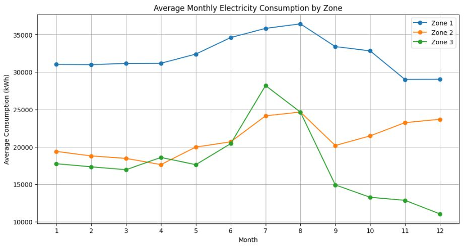
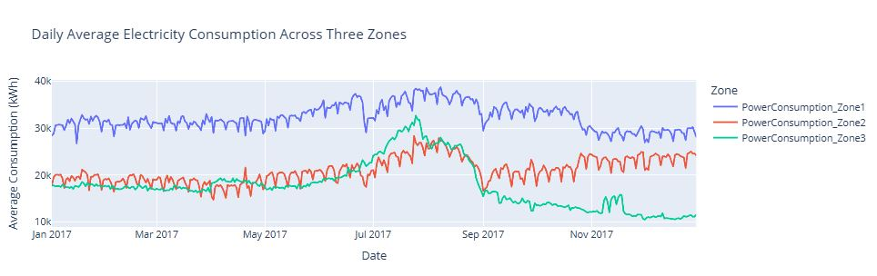
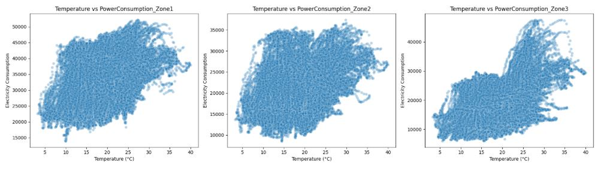
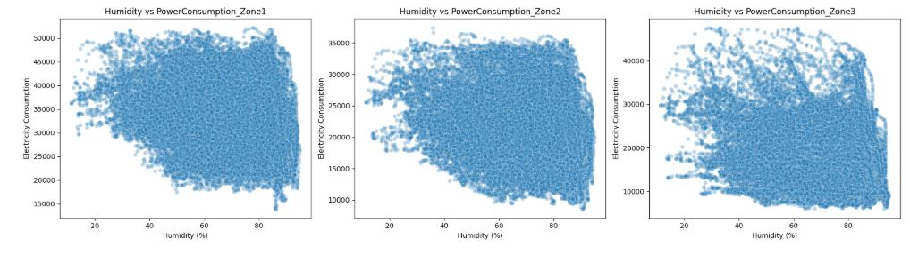
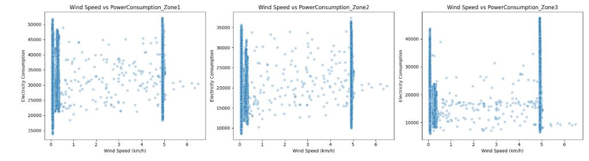

# Morocco Electricity Consumption & Environmental Factors Analysis

**Exploratory Data Analysis | Python | Energy Analytics**

## Project Overview

How does electricity demand change throughout the year, and what factors might be associated with those changes?

This project explores electricity consumption across three geographical zones in Morocco using historical electricity and environmental data from 2017.

The analysis focuses on identifying consumption patterns, comparing electricity usage across the three zones, and examining the relationship between electricity consumption and environmental conditions.

The goal is to turn the findings into useful insights that can support better energy monitoring, demand planning and resource allocation.

## Business Problem

An energy management organisation wants to better understand electricity consumption across its three operational zones.

Understanding when and where electricity demand is highest can help the organisation plan for peak periods, identify differences in consumption patterns and make more informed energy management decisions.

This project uses historical data to explore these patterns and identify areas that may require attention.

## Project Objectives

The analysis seeks to answer the following questions:

- How does electricity consumption differ across the three zones?
- At what times of the day is electricity demand highest and lowest?
- How does consumption change across different days and months?
- Are temperature, humidity and wind speed associated with electricity consumption?
- What insights can support better energy planning and management?

## Dataset Overview

The dataset contains **52,416 records** collected at 10-minute intervals between January 1 and December 30, 2017.

It contains nine original columns covering:

| Category | Variables |
|---|---|
| Date and time | Datetime |
| Environmental measurements | Temperature, Humidity, WindSpeed |
| Diffuse flow measurements | GeneralDiffuseFlows, DiffuseFlows |
| Electricity consumption | PowerConsumption_Zone1, PowerConsumption_Zone2, PowerConsumption_Zone3 |

**Dataset files:**

- `powerconsumption.csv` – Main electricity consumption dataset.
- `powerconsumption_datadictionary.csv` – Description of the dataset columns.

## Tools and Technologies

- **Python:** Data analysis and exploration.
- **Jupyter Notebook:** Analysis environment.
- **Pandas:** Data cleaning, transformation and aggregation.
- **NumPy:** Numerical operations.
- **Matplotlib:** Data visualisation.
- **Seaborn:** Statistical visualisation.
- **Plotly:** Interactive visualisation.

## Analytical Approach

The project followed these stages:

**1. Data Inspection**

Examined the dataset structure, column types, date range, missing values, duplicate records and descriptive statistics.

**2. Data Cleaning and Preparation**

Converted the datetime column, checked for missing values and duplicate timestamps, investigated potential outliers and created additional time-based columns for analysis.

**3. Exploratory Data Analysis**

Compared electricity consumption across the three zones and examined hourly, daily, weekday/weekend and monthly patterns.

**4. Environmental Analysis**

Used correlation analysis and scatter plots to investigate the relationship between electricity consumption and temperature, humidity and wind speed.

**5. Visualisation and Business Insights**

Created visualisations to communicate the findings and developed recommendations based on the observed patterns.

## Key Findings

**1. Zone 1 recorded the highest average electricity consumption.**

| Zone | Average Consumption |
|---|---:|
| Zone 1 | 32,344.97 |
| Zone 2 | 21,042.51 |
| Zone 3 | 17,835.41 |

Zone 2 recorded approximately 34.9% less average consumption than Zone 1, while Zone 3 recorded approximately 44.9% less.

**2. Electricity consumption peaked around 8 PM.**

All three zones recorded their highest average hourly consumption at 8 PM.

- Zone 1: 43,822.59
- Zone 2: 28,186.91
- Zone 3: 26,027.61

This highlights the importance of evening demand when planning electricity supply.

**3. Consumption varied across the months.**

Zones 1 and 2 recorded their highest monthly average consumption in August, while Zone 3 peaked in July. Zone 3 also experienced a noticeable decline towards the end of the year.

**4. Weekday and weekend patterns differed across the zones.**

Zones 1 and 2 recorded higher average consumption on weekdays, while Zone 3 had slightly higher average consumption during weekends.

**5. Temperature showed the strongest positive relationship with electricity consumption.**

Correlation values ranged from 0.38 to 0.49 across the three zones. Humidity showed a weak negative relationship, while wind speed had a very weak positive relationship.

These results indicate associations, not proof of cause and effect.

## Data Visualisations

The following charts highlight the major patterns identified during the analysis.

### 1. Average Electricity Consumption Across the Three Zones



### 2. Hourly Electricity Consumption Patterns



### 3. Monthly Electricity Consumption Patterns



### 4. Daily Electricity Consumption Trends



### 5. Environmental Factors and Electricity Consumption







## Business Recommendations

Based on the findings, the following actions are recommended:

- **Prioritise Zone 1 monitoring:** Its higher average consumption makes it an important area for energy monitoring and efficiency reviews.
- **Prepare for evening peak demand:** Energy planning should account for the higher consumption observed around 8 PM.
- **Use historical trends for seasonal planning:** Monthly patterns can help anticipate periods of increased demand.
- **Adopt zone-specific strategies:** Differences in consumption patterns suggest that each zone may require a different approach to energy management.
- **Explore demand forecasting:** Temperature could be investigated further as a potential variable in electricity demand forecasting.

## Limitations of the Analysis

While working on this dataset, I encountered a few limitations that are worth mentioning:

- **Unusual wind speed distribution:** One thing I noticed during the analysis was that most wind speed readings were concentrated around very low values, while another noticeable group appeared around 4.9. The median was 0.086, compared to a mean of 1.96. This unusual distribution made it difficult to interpret the variable confidently. I could not establish whether it was related to the data collection process, measurement method or actual weather conditions, so I retained the values and treated the results cautiously.

- **Unclear variable descriptions:** The data dictionary did not provide enough clarity on what `GeneralDiffuseFlows` and `DiffuseFlows` represented. This made it difficult to interpret these variables fully and understand their relevance to electricity consumption.

- **Potential outliers:** The IQR method identified 7 potential outliers in Zone 2 and 1,191 in Zone 3. I did not remove them because there was no clear evidence that they were incorrect readings. However, their influence on the analysis could be investigated further.

- **Limited time coverage:** The dataset covered only 2017. Although the 10-minute readings provided enough detail to examine daily and monthly patterns, data from additional years would make it possible to explore longer-term trends and compare consumption across different years.

- **Correlation does not establish causation:** The analysis revealed relationships between environmental factors and electricity consumption, particularly temperature. However, these relationships do not prove that environmental conditions directly caused changes in electricity demand. Other factors not captured in the dataset may also have influenced consumption.

These limitations were considered when interpreting the results. Using more detailed environmental information, clearer variable definitions and data covering additional years could provide a better understanding of electricity consumption patterns.

## Project Deliverables

- Jupyter Notebook containing the complete analysis.
- Cleaned dataset.
- Original dataset and data dictionary.
- Analytical report in PDF format.
- Data visualisations.
- Business insights and recommendations.

## How to Reproduce the Analysis

1. Clone or download this repository.
2. Install Python and Jupyter Notebook.
3. Install the required libraries:

   ```bash
   pip install pandas numpy matplotlib seaborn plotly
