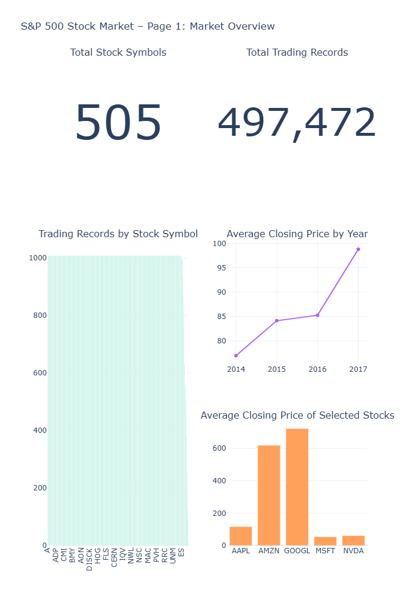
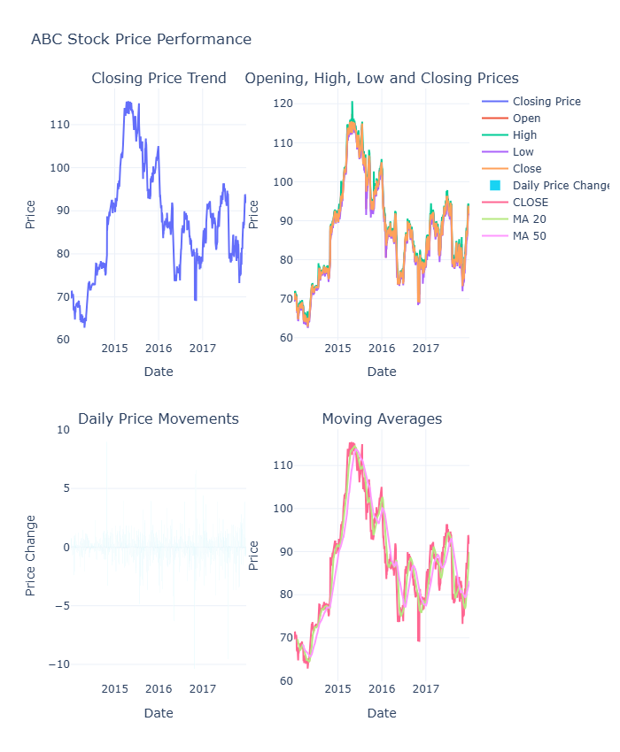
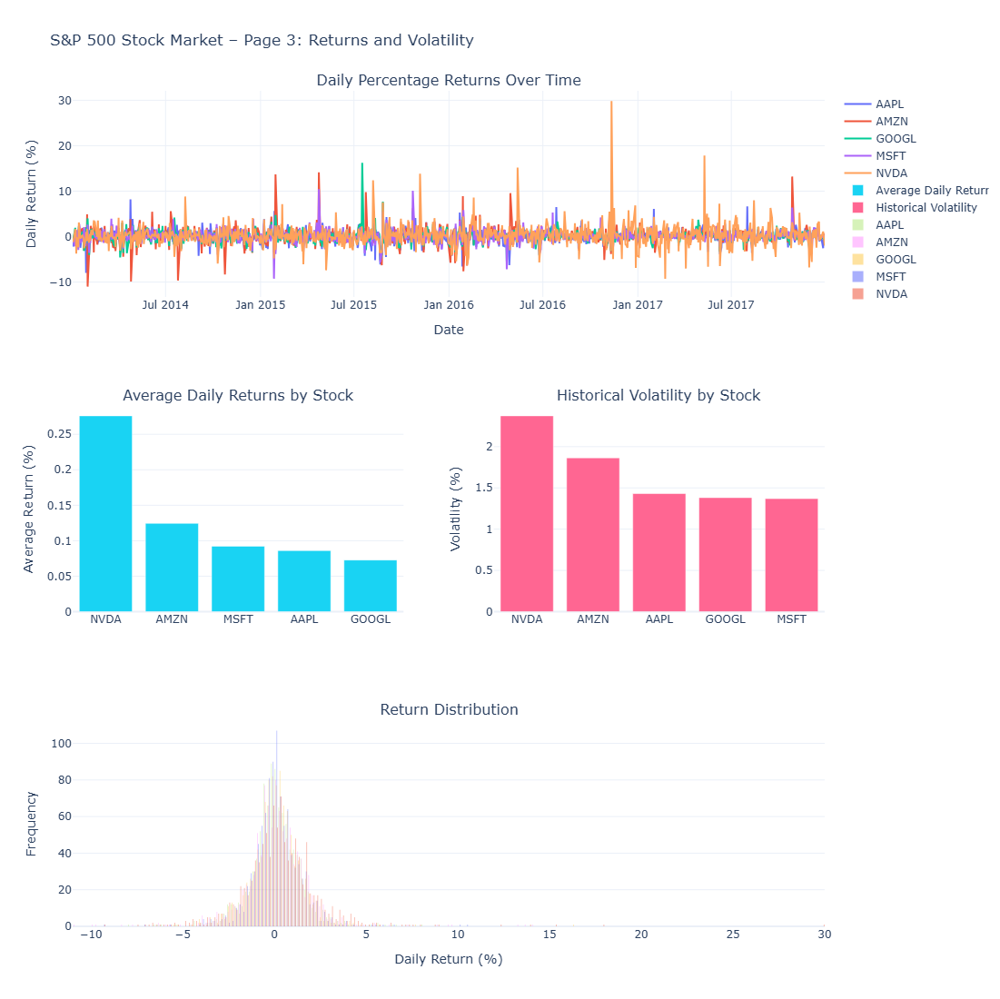
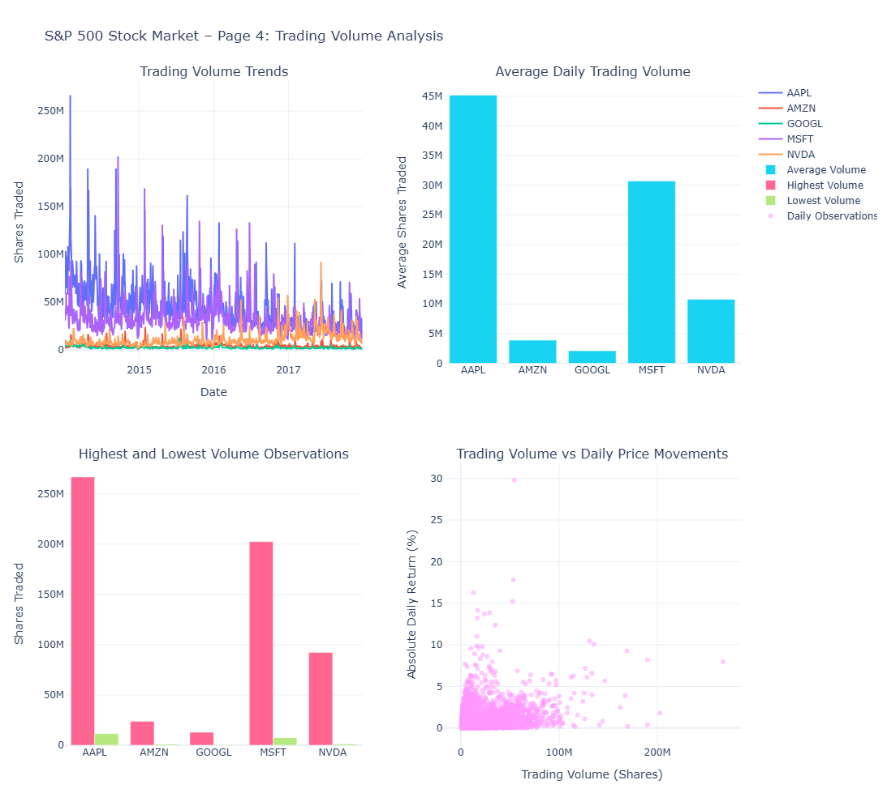

# S&P 500 Stock Market Performance, Statistical Analysis and Predictive Intelligence Platform

## Project Overview

This project involved analysing historical stock market data covering 2014 to 2017 to understand stock price performance, daily returns, volatility and trading activity.

The analysis covered 505 stock symbols and approximately 497,472 trading records. Five stocks (AAPL, AMZN, GOOGL, MSFT and NVDA) were selected for a more detailed comparison of their historical performance.

Python was used for data preparation, analysis and visualisation, while Plotly was used to develop an interactive dashboard that allows users to explore stock performance and compare different stocks over selected periods.

The project also involved identifying data quality issues, calculating important stock market metrics and presenting findings that can support historical market analysis.

## Business Problem

Stock market data contains several measures that can be used to understand how stocks perform. However, looking at closing prices alone does not give a complete picture of stock performance.

There is a need to examine daily returns, cumulative price returns, volatility and trading volume to understand how stocks behaved over time.

This project addresses that need by analysing historical stock data and presenting the results through visualisations and an interactive dashboard.

## Project Objectives

The main objectives of this project were to:

- Examine and understand the structure and quality of the stock market dataset.
- Prepare the dataset for analysis.
- Calculate daily price changes and percentage returns.
- Analyse stock prices, returns, volatility and trading volume.
- Compare the historical performance of selected stocks.
- Identify patterns and differences across stock symbols and years.
- Develop an interactive dashboard using Plotly.
- Present meaningful findings and recommendations based on the analysis.

## Dataset Description

The dataset used for this project was:

**S&P 500 Stock Prices 2014–2017.csv**

The dataset contains daily stock market records for 505 stock symbols.

| Dataset Information | Details |
|---|---|
| Total Records | 497,472 |
| Total Columns | 7 |
| Stock Symbols | 505 |
| Start Date | 2 January 2014 |
| End Date | 29 December 2017 |
| Data Frequency | Daily |

### Dataset Columns

| Column | Description |
|---|---|
| symbol | Stock ticker symbol |
| date | Trading date |
| open | Opening price |
| high | Highest price recorded |
| low | Lowest price recorded |
| close | Closing price |
| volume | Number of shares traded |

## Tools and Technologies

The following tools and libraries were used:

- **Python:** Main programming language.
- **Jupyter Notebook:** Data analysis and documentation.
- **Pandas:** Data manipulation and preparation.
- **NumPy:** Numerical calculations.
- **Matplotlib:** Data visualisation.
- **Seaborn:** Statistical visualisation.
- **Plotly:** Interactive charts and dashboard development.
- **ipywidgets:** Interactive stock and date selection controls.

## Data Preparation and Cleaning

The dataset was inspected to understand its structure, data types and quality before analysis.

The following steps were carried out:

- Loaded the CSV file into a Pandas DataFrame.
- Checked the number of rows and columns.
- Examined column data types.
- Identified the unique stock symbols.
- Converted the date column to datetime format.
- Sorted the records by stock symbol and date.
- Checked for missing values and duplicate records.
- Examined stocks with incomplete trading histories.
- Identified zero-volume observations.
- Checked for unusual and inconsistent price relationships.

### Missing Value Treatment

The dataset contained 27 missing values across the opening, highest and lowest price columns.

| Column | Missing Values |
|---|---:|
| Open | 11 |
| High | 8 |
| Low | 8 |
| Close | 0 |
| Volume | 0 |

The missing values were not automatically replaced with zero because this could affect the calculations. They were identified and documented.

No duplicate records or duplicate stock-date combinations were found.

Four zero-volume observations were also identified. These records had missing opening, highest and lowest prices.

In addition, 26 stocks had fewer than the full 1,007 available trading dates.

Twelve records were identified with inconsistent relationships between opening, highest, lowest and closing prices. These observations were flagged rather than automatically corrected or deleted.

## Calculated Metrics

The following additional columns were created during data preparation:

- **Year:** Extracted from the trading date.
- **Month:** Extracted from the trading date.
- **Quarter:** Extracted from the trading date.
- **Daily Price Change:** Difference between the current closing price and the previous available closing price for each stock.
- **Daily Percentage Return:** Percentage change in closing price from the previous available trading observation.
- **Daily Trading Range:** Difference between the highest and lowest prices.
- **20-Day Moving Average:** Average closing price over the previous 20 trading observations.
- **50-Day Moving Average:** Average closing price over the previous 50 trading observations.

All daily return and moving average calculations were performed separately for each stock and in chronological order.

## Key Performance Indicators (KPIs)

The analysis included the following important metrics:

| KPI | Description |
|---|---|
| Total Stock Symbols | Number of unique stock symbols |
| Total Trading Records | Total number of records in the dataset |
| Average Closing Price | Average closing price for a stock |
| Daily Percentage Return | Daily percentage change in closing price |
| Cumulative Price Return | Percentage change between first and last available closing prices |
| Average Daily Return | Average of daily percentage returns |
| Historical Volatility | Standard deviation of daily percentage returns |
| Average Trading Volume | Average number of shares traded |
| Highest Trading Volume | Highest recorded trading volume |
| Lowest Trading Volume | Lowest recorded trading volume |
| 20-Day Moving Average | Average closing price over 20 trading observations |
| 50-Day Moving Average | Average closing price over 50 trading observations |

## Interactive Dashboard

An interactive dashboard was developed using Plotly. It contains four pages covering different aspects of stock market performance.

### Page 1: Market Overview

This page provides a general overview of the dataset.

It includes:
- Total stock symbols.
- Total trading records.
- Trading record distribution across stock symbols.
- Average closing price by year.
- Average closing prices for selected stocks.

**Dashboard Preview**

### Page 2: Stock Price Performance

This page focuses on the historical price movements of selected stocks.

It includes:
- Closing price trends.
- Opening, highest, lowest and closing price comparisons.
- Daily price movements.
- 20-day and 50-day moving averages.
- Stock symbol selection.
- Date range filtering.

**Dashboard Preview**

### Page 3: Returns and Volatility

This page examines the daily returns and historical volatility of the selected stocks.

It includes:
- Daily percentage returns over time.
- Average daily returns by stock.
- Historical volatility comparison.
- Distribution of daily percentage returns.

**Dashboard Preview**

### Page 4: Trading Volume Analysis

This page examines trading activity and its relationship with daily price movements.

It includes:
- Daily trading volume trends.
- Average daily trading volume.
- Highest and lowest trading volume observations.
- Relationship between trading volume and absolute daily percentage returns.
- Stock symbol selection.
- Date range filtering.

**Dashboard Preview**

## Key Business Insights

The analysis produced the following findings:

**1. NVDA recorded the highest cumulative price return among the five selected stocks.**

NVDA recorded approximately 1,120.05%, followed by AMZN at 193.86%, MSFT at 130.19%, AAPL at 114.17% and GOOGL at 89.08%.

**2. NVDA also had the highest volatility among the selected stocks.**

NVDA recorded historical volatility of 2.3739%, while MSFT had the lowest at 1.3695%. This shows that higher historical returns can also come with larger daily price movements.

**3. AAPL and MSFT recorded the highest average daily trading volumes among the selected stocks.**

AAPL recorded approximately 45.17 million shares, while MSFT recorded approximately 30.71 million shares in average daily trading volume.

**4. The average closing price across the dataset increased between 2014 and 2017.**

The average closing price increased from approximately 76.97 in 2014 to 98.80 in 2017.

**5. Different stocks recorded different price levels, returns and volatility.**

PCLN recorded the highest closing price in the dataset at 2,049.00. Across all stocks, NVDA had the highest average daily percentage return at 0.2760%, while CHK recorded the highest volatility at approximately 4.55%.

## Business Recommendations

Based on the findings, the following recommendations were made:

**1. Consider both returns and volatility when comparing stocks.**

NVDA recorded the highest cumulative price return among the five selected stocks but also had the highest volatility. Analysts and investors should consider both measures when assessing historical stock performance.

**2. Monitor trading volume alongside daily price movements.**

AAPL and MSFT recorded the highest average daily trading volumes among the selected stocks. Analysts can use trading volume and price movement comparisons to identify unusual market activity and investigate those periods further.

**3. Use interactive dashboards to compare and monitor stock performance.**

The dashboard allows users to select stock symbols and date ranges. Analysts can use these features to compare stocks, examine historical movements and prepare reports based on selected periods.

## Limitations

The following limitations were considered when interpreting the results:

- The dataset covers 2014 to 2017 and does not represent current stock market performance.
- The dataset does not contain adjusted closing prices. Therefore, cumulative returns are price returns and do not account for dividends or adjustments for corporate actions.
- Not all stock symbols have the same number of trading records.
- The average closing price across all stocks is not the same as the S&P 500 index return.
- Historical performance does not guarantee future results.

## Skills Demonstrated

- Python programming
- Data cleaning and preparation
- Exploratory Data Analysis (EDA)
- Data quality assessment
- Statistical analysis
- Data transformation using Pandas and NumPy
- Financial data analysis
- Data visualisation
- Interactive dashboard development using Plotly
- KPI calculation
- Business insights and recommendations
- Analytical reporting and documentation

## Conclusion

This project provided an opportunity to work with historical stock market data and examine how different stocks performed between 2014 and 2017.

The analysis showed differences in stock price movements, returns, volatility and trading activity. It also demonstrated the importance of using different performance measures when comparing stocks.

The interactive dashboard brings the analysis together and allows users to explore the data using stock selection and date filters.

Overall, the project strengthened my experience in Python-based data analysis, data visualisation and presenting findings in a way that can support business understanding and decision-making.

---

**Project:** S&P 500 Stock Market Performance Analysis  
**Programme:** AnalystLab Africa – Data Analytics Internship  
**Tools:** Python, Jupyter Notebook, Pandas, NumPy, Matplotlib, Seaborn, Plotly and ipywidgets  
**Project Type:** Data Analytics and Interactive Dashboard Development
